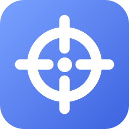
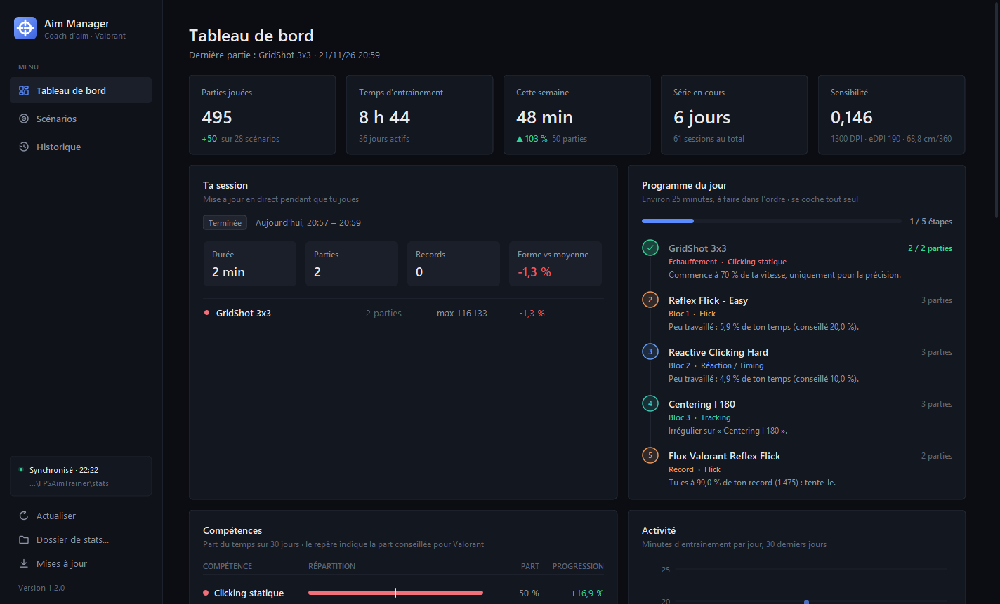
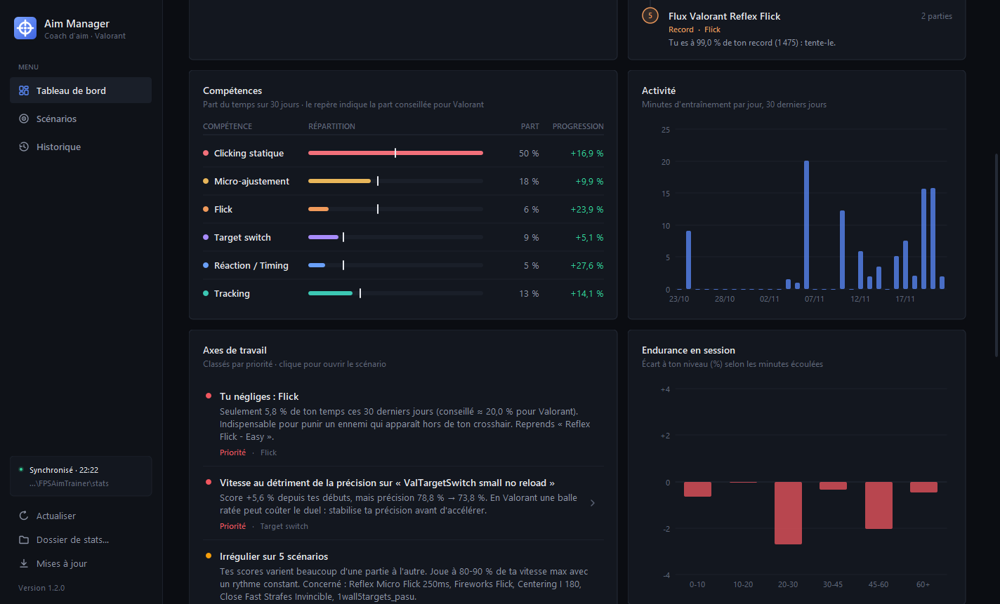
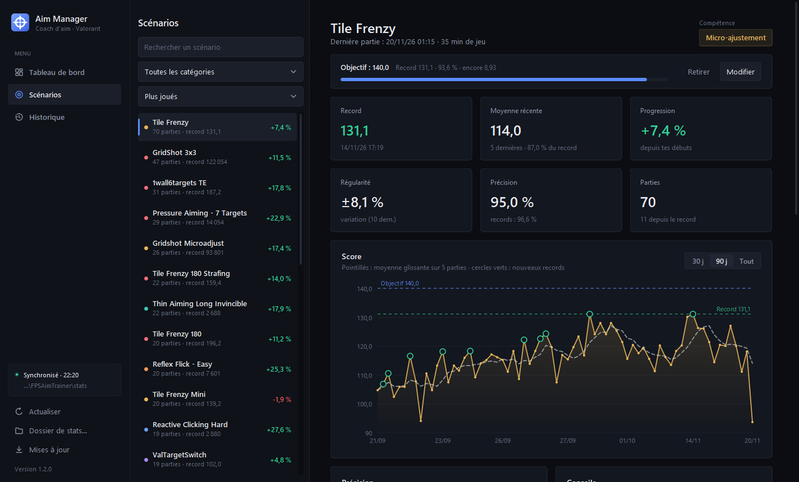
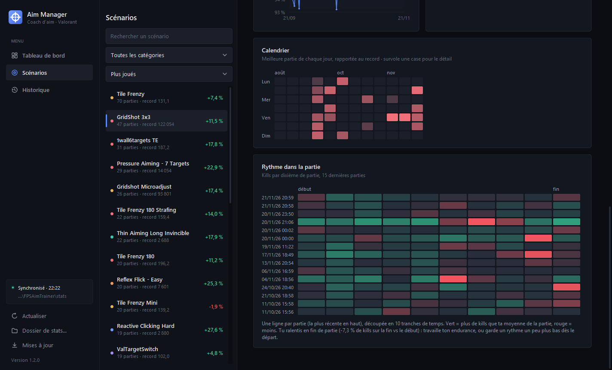
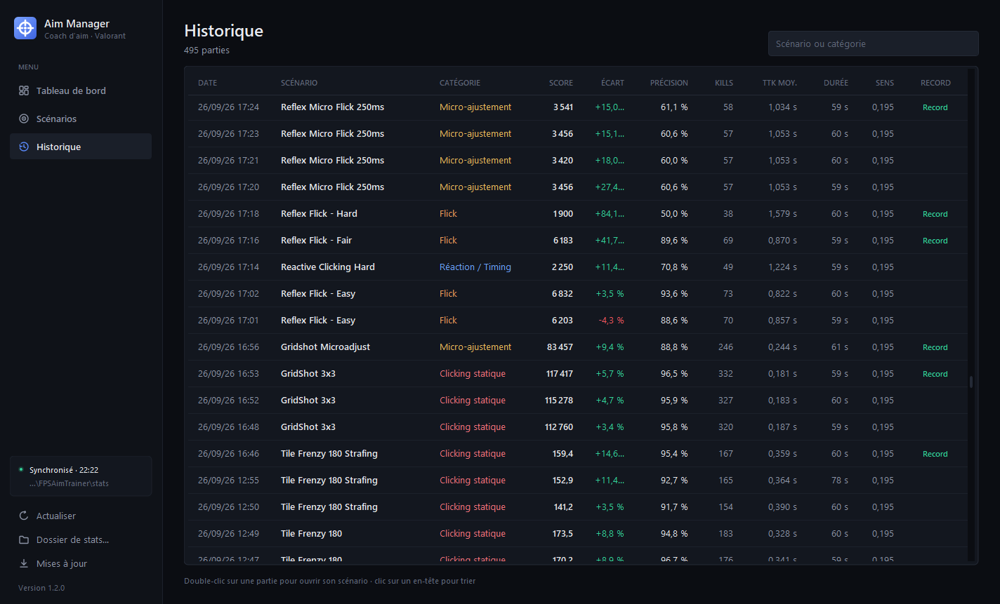

  

<h1 align="center">Aim Manager</h1>

  <b>Ton coach d'aim, de KovaaK's à Valorant.</b> 
  Aim Manager lit tes parties KovaaK's, suit ta progression et te dit quoi travailler.

  
  
  

  <a href="https://github.com/FireWxt/aim-manager-releases/releases/latest"><b>⬇&nbsp; Télécharger la dernière version</b></a>

  

---

## ✨ Fonctionnalités

| | |
|---|---|
| 🎯 **Conseils personnalisés** | Compétences négligées, plateaux, précision sacrifiée pour la vitesse, overflicks, irrégularité… rangés par priorité. |
| ⏱️ **Récap de session** | Pendant que tu joues : durée, parties, records battus, forme par rapport à ta moyenne et détail par scénario. |
| 🗓️ **Programme du jour** | Une session d'environ 25 min : échauffement, 3 blocs sur tes points faibles, puis une tentative de record. Les étapes se cochent toutes seules au fil de tes parties. |
| 🏁 **Objectifs** | Fixe un score à atteindre sur un scénario : barre de progression, ligne d'objectif sur la courbe et notification quand tu l'atteins. |
| 📊 **Profil par compétence** | Clicking, micro-ajustement, flick, target switch, timing, tracking : ton temps passé sur chacune, comparé à la répartition conseillée pour Valorant. |
| 📈 **Suivi par scénario** | Courbe de score (30 jours, 90 jours ou tout), moyenne glissante, records, précision, régularité, progression depuis tes débuts. |
| 🔥 **Heatmaps** | Un calendrier de tes meilleures journées, et le rythme de tes kills au fil de la partie pour voir où tu ralentis. |
| 🔔 **En direct** | L'app se met à jour dès que tu finis une partie, avec une notification Windows quand tu bats un record. |
| ⚙️ **Réglages** | Vérifie que KovaaK's est réglé comme Valorant (sens, FOV 103), et calcule ton eDPI et ton cm/360. |

  

  
  

  

## 🚀 Installation

1. Télécharge **`AimManager-x.y.z.zip`** dans la [dernière release](https://github.com/FireWxt/aim-manager-releases/releases/latest).
2. Dézippe-le où tu veux, par exemple dans `%LOCALAPPDATA%\AimManager`.
3. Lance **`AimManager.exe`**. Tu peux l'épingler à ta barre des tâches.

Rien d'autre à installer : Java est inclus dans le zip.

> [!NOTE]
> Au premier lancement, Windows SmartScreen peut afficher « Windows a protégé votre ordinateur », car l'application n'est pas signée.
> Clique sur **Informations complémentaires**, puis sur **Exécuter quand même**.

Le dossier de stats KovaaK's (`steamapps\common\FPSAimTrainer\FPSAimTrainer\stats`) est trouvé automatiquement, même dans une autre bibliothèque Steam.
Si ce n'est pas le cas, choisis-le avec le bouton **Dossier de stats…**.

## 🔄 Mises à jour

Elles sont automatiques. Au démarrage, Aim Manager regarde s'il existe une nouvelle version. Si oui, clique sur **Installer maintenant** : l'app la télécharge, se ferme, se met à jour et redémarre.
Tu peux aussi vérifier à tout moment avec le bouton **Mises à jour**.

> [!IMPORTANT]
> Si tu as la **version 1.0.0**, installe la 1.1.0 à la main une seule fois (comme une installation normale) : la mise à jour automatique de la 1.0.0 ne fonctionnait pas.

## 🎮 Conseils pour de bons résultats

- **Règle KovaaK's comme Valorant** : échelle de sensibilité « Valorant » avec ta sens de jeu, et FOV 103 en échelle « Valorant ». L'app te prévient si ce n'est pas le cas.
- **Répète les mêmes scénarios** : 1 à 2 par compétence suffisent. L'analyse détaillée d'un scénario commence à partir de 8 parties.
- **Une catégorie mal devinée ?** Fais un clic droit sur le scénario dans la page *Scénarios* pour la corriger.

## ❓ FAQ

<b>Mes données sont-elles envoyées quelque part ?</b>

Non. Aim Manager lit uniquement les fichiers de stats de KovaaK's sur ton PC. Sa seule connexion à Internet sert à vérifier s'il existe une nouvelle version sur cette page GitHub.

<b>Où sont enregistrés mes réglages ?</b>

Dans `%APPDATA%\AimManager\config.properties` : le dossier de stats choisi et les catégories que tu as corrigées. Ils sont conservés lors des mises à jour.

<b>Comment désinstaller ?</b>

Supprime le dossier de l'app et `%APPDATA%\AimManager`. C'est tout.

<b>Pourquoi la heatmap de rythme est-elle vide sur mes scénarios de tracking ?</b>

KovaaK's n'enregistre des kills que sur les scénarios où les cibles meurent. Sur le tracking (Controlsphere, Thin Aiming…), il n'y a pas de kills à répartir dans le temps.

---

Projet indépendant, sans lien avec KovaaK's ni Riot Games.

